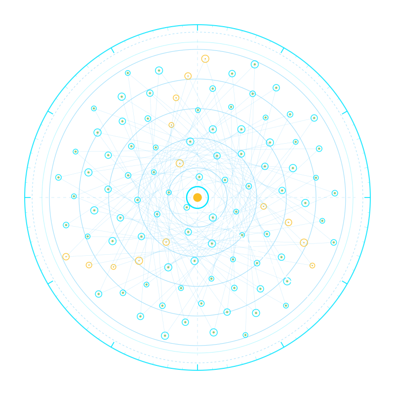

# 👁️ Argus (`argus-dist`) — Official Distribution & Verification Hub

> **The All-Seeing Sovereign Fleet Radar, Linux PSI Somatic Pressure & Real-Time TUI Command Bridge**  
> *Zero cloud dependencies • Pure safe Rust • Musl static standalone binary • 100% Adversarial TDD Tested*

[](https://github.com/rmediatech/argus-dist/releases/tag/v0.3.0)
[](https://rmediatech.com/downloads)
[-blue.svg)](#)
[](#)
[-blueviolet.svg)](SOVEREIGN_RELEASE_KEY.asc)
[](https://rmediatech.com)
[](LICENSE)

<p align="center">
  
</p>

---

## 🏛️ Overview

**Argus** is an enterprise-grade, zero-cloud tactical fleet radar and real-time terminal HUD written in 100% safe Rust. Endowed with the vigilance of its hundred-eyed namesake, Argus unifies somatic Linux kernel pressure monitoring (PSI), AI/LLM process radar, Smart TV cinema ADB telemetry, and live fleet node health into a sub-15MB memory footprint.

### Core Capabilities
* **All-Seeing Polar Radar Sweep**: Real-time terminal HUD rendered purely in text via Ratatui and Crossterm, featuring circular sweeps, live blip pings, and latency sparklines.
* **Linux Kernel PSI Somatic Pressure**: Zero-dependency monitoring of kernel CPU, memory, and I/O pressure stall information (`/proc/pressure/*`), detecting resource exhaustion before daemons drop packets.
* **Autonomous AI/LLM Process Radar**: Automatically discovers and classifies background inference engines (`ollama`, `vllm`, `llama-server`) and coding agents (`antigravity`/`agy`), monitoring thread contention and resident memory.
* **Crash-Resilient RAII Terminal Guard**: Features an atomic RAII terminal guard with a global panic hook, guaranteeing pristine terminal restoration without screen freezing or cursor loss.
* **Single Standalone Static Binary**: Statically linked against Musl libc, self-contained, with $<15\text{MB}$ memory footprint.

---

## 📦 Binary Verification & Download

Verified standalone binaries are distributed directly through the **[RMediaTech Sovereign Binary Vault](https://rmediatech.com/downloads)**:

| Platform | Architecture | Checksum (SHA-256) | Vault Download |
| :--- | :--- | :--- | :--- |
| **Linux (Static Musl)** | `x86_64` | `48375d6a83ef0ba2853700b5181c66b05a56550507ae76f1ae7c6e9553022cab` | [Download (3.0 MB)](https://rmediatech.com/bin/argus) |

### 1-Click Stream Download & Installation
```bash
# 1-Click Stream Install
curl -sSL https://rmediatech.com/install/argus | sh

# Or Direct Binary Download
curl -sSL https://rmediatech.com/bin/argus -o argus
chmod +x argus
```

### Cryptographic Provenance Verification (`SOVEREIGN-SIGN-01`)
All releases are cryptographically sealed by `Rick Walker (Sovereign Release Signing Key) <rick@rmediatech.com>` (Key ID: `4E428019A109578B`):

```bash
# Import Public Key
curl -sSL https://rmediatech.com/SOVEREIGN_RELEASE_KEY.asc | gpg --import

# Verify Detached OpenPGP Signature
curl -sSL https://rmediatech.com/signatures/argus -o argus.asc
gpg --verify argus.asc argus
```

---

## 🚀 Quickstart

```bash
# Launch interactive TUI command bridge
argus

# Inspect somatic kernel pressure and AI process load
argus somatic --json

# Run in ghost mode (redacted IP addresses for public screen shares)
argus --ghost
```

---

## 🛡️ License & Provenance

Dual-licensed under MIT OR Apache-2.0. Cryptographically sealed by Rick Walker (`4E428019A109578B`).
